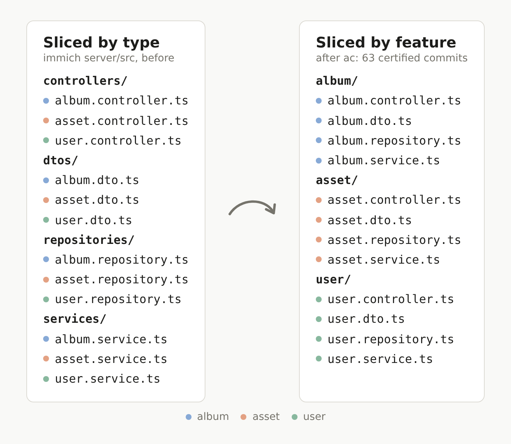

# architecture-cleaner (`ac`)

**Nemotron draws the map. Code moves it. A checker proves nothing else changed.**



`ac` restructures a TypeScript backend that is sliced by technical type (`controllers/`, `services/`, `repositories/`,
`dtos/`) into feature modules (`modules/<feature>/`, `platform/<concern>/`, `shared/`), one commit per step, without
changing behavior. Every commit carries a certificate that says why nothing else changed. The pitch is proof, not
trust: you don't have to believe the tool, or the model, because a separate checker certifies every diff.

On immich's server, `ac run` made 63 commits unattended in 1 h 55 m, each certified; on the whole PR, tsc, the
2,337-case unit suite and the OpenAPI spec come out equal to base. A generic coding agent given the same task on the
same Nemotron model left 1,638 imports dangling. To check it yourself, with no key and no cost: clone, `npm ci`,
`npx ac demo --replay` (about 11 minutes; see the quick start).

Entry for the Nebius x NVIDIA Global AI Hackathon, Coding and Agentic Engineering track.

**The video (2:53): [youtu.be/VJoate5NmEM](https://youtu.be/VJoate5NmEM)**, with chapters and English captions.


**The replay site: [corupta.github.io/architecture-cleaner](https://corupta.github.io/architecture-cleaner/)**, every
recorded run with its certificates and findings, the A/B against a generic agent, and the benchmarks, rendered from
the committed artifacts (nothing on it calls a model). To rebuild it, and everything it shows, see the quick start.

## How it works

- **The plan.** Deterministic code reads the repository (imports, DI wiring, tables, routes) and draws a seeds draft.
  Nemotron 3 Ultra edits that draft and then reviews the result. Every change it suggests goes through a validator
  gate, and a review change that joins an existing group without evidence (an import edge, a table, a route) is
  dropped.
- **The moves.** An executor built on the TypeScript compiler API moves the files and rewrites only the import
  specifiers that point at them. Every other byte stays identical. No model writes code.
- **The ladder.** R0 preflight and a baseline of the target's own tests. R1 moves one feature module per commit. R2
  moves platform code and `shared/`. R3 normalizes file names. An optional S3 re-wraps the import lines the moves
  made too long for the target's prettier. R4 adds dependency-cruiser boundary rules with a frozen baseline of today's
  violations.
- **The certificate.** `ac certify` is a separate program that never imports the executor, and it certifies any
  diff: ours, an agent's, a human's. It reads the two git trees and checks, among other things:
  - K0: the support envelope;
  - K1: that the move set is complete;
  - K2: that only specifier bytes changed, or the layout only (equal tokens and syntax trees);
  - K3: that every import resolves to the same file under TypeScript, the test runner and the runtime;
  - K4: that no path string, config or CI file still names an old path;
  - K6: that the test inventory is the same, file by file;
  - K7: that the emit layout is the same;
  - K8, with `--oracles`: the target's own oracles (tsc, the unit suite, immich's OpenAPI spec), which must agree with
    the base commit. `ac run` runs them on each rung and on the whole PR, not on each move step.

  A failing step is rolled back and replanned.
- **The findings log.** Bugs and smells that the new layout makes obvious are written down and never fixed, for
  example an import cycle through 42 folders (R4's count over 73 folders; 41 of 70 in the site's folder graph, which
  counts a nested folder such as `src/schema/tables/` under its top folder), or a base class that injects 56 members into 51 services.

## Nemotron on Nebius Token Factory

Nemotron only plans and narrates. Code moves the files, and the certificate checks them.

| Model (Token Factory id) | What it does here | On immich |
|---|---|---|
| **Nemotron 3 Ultra** (`nvidia/Nemotron-3-Ultra-550b-a55b`, `medium_effort`) | Edits the seeds draft: 3 candidates in one `n=3` call, strict `json_schema`, ranked by the validator. Then reviews the winning plan like a staff engineer; the gate drops any change that adds a warning or joins an existing group without evidence. | 2 calls, **$0.1998**, recorded once (`runs/immich-ladder/run.json`, `cost.planRecordedUsd`) |
| **Nemotron 3.5 Lightning** (`nvidia/Nemotron-3_5-Lightning`, thinking off) | Narrates the findings log in 1–2 sentences per finding, under a lexical guard that drops any narration naming something its evidence doesn't contain. | 2 calls, **$0.0010**; 40 of the 45 findings sent (the cap is 40), 35 narrated: the guard dropped 4, and 1 came back with no narration |
| **Nemotron 3 Super** (`nvidia/nemotron-3-super-120b-a12b`) | The baseline: a generic coding agent (opencode 1.18.34) given the same task with no help from `ac` (gate G3). | $0.30 single-shot, $4.63 persistent ([docs/gates.md](docs/gates.md)) |
| **Nemotron 3 Ultra**, again (opencode's default settings) | The baseline's second arm (S9): the same agent, prompt and scripts on the model `ac` plans with. | $0.55 single-shot, $2.55 persistent, billed (their caps counted $1.86 and $11.76 at the full input price); both fail (below) |
| **Nemotron 3.5 Super VL** (`nvidia/Nemotron-3.5-Super-VL`) | Measured as an alternative planner, three runs per bench entry (S8b to S8d). With thinking on and room to reason (256k tokens per edit answer and 128k for the critic, streamed), it beats Ultra on the four scrambles (hoppscotch MoJoFM 91.26 against 83.22, TurboMQ 8.32 against 7.86) at 2.5 times the cost (at the full input price) and 6.4 times the time; on immich it shows no measurable difference. With thinking off it costs a fifth of Ultra and scores below it on immich's TurboMQ and, less clearly, hoppscotch-H1's MoJoFM. `ac plan --planner super-vl-256k` or `super-vl-direct`. | $8.37 on the bill for its runs and probes ($9.16 in the gateway's ledger: the full input price, plus $0.70 booked for a cut call that wasn't billed; [bench/experiments/s8b-super-vl](bench/experiments/s8b-super-vl/README.md)) |

Every call goes through one in-process gateway (`src/gateway/`):
- strict `json_schema` answers, explicit sampling and `max_tokens` caps;
- reasoning controlled only through `chat_template_kwargs`;
- every request and response recorded in a cassette (`cassettes/*.jsonl`), keyed by a hash of the request, so a
  replay is byte-identical, free, and needs no key;
- a budget ledger (`budget/ledger.jsonl`) with hard caps per run and overall (`budget/runs.json`): the gateway
  refuses a call whose pre-send estimate would cross a cap.

The ledger matched the Nebius console bill on 2026-10-14, at **$9.31**. $6.69 of it went to Nemotron 3 Super, mostly
the G3 baseline runs ($5.79); the immich plan and narration cost $0.20 ([docs/sessions/s6.md](docs/sessions/s6.md)).
Since then the benchmarks' recordings added $1.12 (S7) and $0.11 (S8), the Super VL experiments $11.72 (S8b to S8d,
Ultra's comparison runs included) and G3's Ultra arm $13.70 (S9, its smoke test included), as the gateway charged them
(every input token at the full price, the 504 below at its estimate): $35.96 in all. The console's bill for the whole hackathon (2026-09-24 to 10-24) came to
**$24.40**, and it reconciles with the ledger to the cent. Since 2026-10-20 at the latest Token Factory bills cached input at a
lower price (Ultra $0.12/M against $1.00, Super VL $0.06/M against $0.30), which the gateway didn't price: $10.77 on Ultra,
$0.09 on Super VL. And it didn't bill the non-streamed call cut at 600 s, which the gateway had booked at its $0.70
estimate, and shows no sign of a call we stopped before it was answered ([docs/feedback.md](docs/feedback.md) #37, #30). Reconciliation
lines in `budget/ledger.jsonl` record each difference, so the ledger, the gateway and `ac report` now say $24.40 of the
$50 cap. A run's cost below is as the gateway charged it, at the full input price, unless it says "billed".

### Where Token Factory sped the work up

- **One endpoint and one key for every Nemotron tier.** Token Factory's API is OpenAI-compatible, so the gateway is
  one client and a model is a row in a table (`src/gateway/models.ts`). Every comparison in this repository was a
  model id, not an integration: the planner gate (G1), the generic-agent baseline on Super and then on Ultra (G3,
  the same scripts), and the Super VL bench (S8b to S8d; its longest answers also needed the gateway to stream, below).
- **Strict `json_schema` on Nemotron.** Token Factory enforces it on every Nemotron model we used, with thinking on
  and off, so the planner parses every finished answer against its schema on the first try, with no repair loop.
- **Three candidates for one prompt.** The planner's three edits come from one `n=3` request, and the prompt (the
  repository's facts) is billed once.
- **Cheap enough to run unattended, and to measure honestly.** immich's plan cost $0.20. Everything in this
  repository, the gates, both baseline arms and the Super VL experiments included, came to $24.40 on Token Factory's
  bill.
- **A bill you can budget against.** Our ledger is built only from response usage and catalog prices, and the
  console's bill matched it on 2026-10-14 ($9.31) and, once cached input was priced, reconciled with it to the cent on
  2026-10-24 ($24.40). So the gateway's hard caps, checked before a call is sent, track what Token Factory bills (they
  err high on cached input, which the gateway prices in full).
- **Room for long reasoning.** Token Factory ends a non-streamed call after 10 minutes; streamed, 37 of Super VL's 45
  edit answers finished within 256k tokens, after a median of about 118k.

**Other Nebius services:** none. `ac` uses no Nebius service but Token Factory (the console aside, for keys and
billing).
No Nebius AI Cloud compute was used: the executor, the certifier, the targets' test suites and the baseline agent all
ran on our own machine, an NVIDIA Jetson AGX Orin (CPU only). What we hit on Token Factory and would ask it to fix,
each with its evidence: [docs/feedback.md](docs/feedback.md).

## Quick start: the replay (no key, $0)

```sh
git clone https://github.com/corupta/architecture-cleaner.git && cd architecture-cleaner
npm ci                  # also builds dist/ (the prepare script)
npx ac demo --replay    # --replay is the default
```

You need Node ≥ 22.12, git, and network access for npm and for one shallow fetch of immich at the pinned commit
(`02063972e8`). The demo works in `/tmp/ac-demo/` (your system's temporary directory) and ends by printing where its
summary is: `/tmp/ac-demo/demo.md`. It doesn't use `./ac-demo` inside this clone, because the clone's `node_modules`
and `package.json` are above it: TypeScript and Node look both up from every tree the certifier checks, so a
certificate made there would depend on them. The certifier refuses such a directory, and so does the demo's `--work`.

What the replay does, and what it proves:
1. **It replays the plan.** The planner's deterministic code runs again on a fresh clone of immich. Nemotron's two
   answers come from `cassettes/s6-immich.jsonl`. The resulting `plan.yaml` must have the sha256 the recorded run
   executed (`b4c7c548883c…`), and `plan.md`, `plan.json` and the four candidates must be byte-identical.
2. **It executes all 62 move steps again** (R1 38, R2 21, R3 3) with the executor, one commit each. Every commit's
   git tree must equal the recorded run's tree for that step. R3's renames are computed again from the tree after R2.
3. **It generates R4's boundary rules again.** This works without immich's node_modules. The rules commit's tree must
   equal the recorded one.
4. **It certifies a sample again** with `ac certify`: the first step, the step that moves the most files (step 4,
   24 files) and an R3 rename (`--sample k` for more). Without node_modules, K0, K1, K2, K3a, K4 and K7 run, and each must give the recorded certificate's
   status. K3b, K3c and K6 skip, and the demo reports them as not compared. So are the checks' content and the
   digests: those are compared only in the recorded environment (`--env`, below).
5. **It replays the findings narration** from the cassette and compares the findings log with the committed one.
   The committed log was itself regenerated from that cassette in S8 (when the renderer started counting
   narrations the model never returned apart from ones the guard dropped), so the two match byte for byte. A log
   narrated live differs from its replay in one flag, `replayed`; the demo allows that one difference and says so.

The command exits 0 when everything it compared matches the recorded run, and 1 when something differs, listing each
difference. It exits 2 when it can't run: a usage error, a refusal (`--oracles` without `--env`, `--live` without a
key, a work dir it won't use) or an error that stops it, such as a failed fetch.
Its summary also lists what it did not compare.
From a fresh clone on our machine (12-core aarch64, 2026-10-23, commit `003e331`, an empty npm cache, nothing else
running), `npm ci` took 16 s and the replay 11 m 08 s, with exit 0; `--steps <n>` stops early.

What the replay does **not** re-run:
- **The oracles (K8)**: tsc, the 105-file unit suite and the OpenAPI spec, on every rung and the whole PR. They need
  immich's node_modules and Node 24.21.0; see the full reproduction below.
- **K3b, K3c and K6** on the sample. These need node_modules too.
- **The run loop**: the baseline, a certificate for every step, the rung certificates, rollback and replan.
  `ac demo --full` runs the whole loop.
- **Nemotron itself.** `ac demo --live` asks it again, on your key.

The recorded run is committed in `runs/immich-ladder/`. It holds every certificate, the rung and whole-PR
certificates, the plan, the findings log and `report.md`.

## The full reproduction

The oracles run immich's own tools under its Node version. The profile pins Node 24.21.0, looked up at
`~/ac-targets/.node/node-v24.21.0-linux-<x64|arm64>/`. This path works on Linux only.

```sh
# Node 24.21.0 for the target (x64 shown; use the arm64 tarball on arm64)
mkdir -p ~/ac-targets/.node
curl -fsSL https://nodejs.org/dist/v24.21.0/node-v24.21.0-linux-x64.tar.xz | tar -xJ -C ~/ac-targets/.node
export PATH=~/ac-targets/.node/node-v24.21.0-linux-x64/bin:$PATH

# immich at the pinned commit, with its server dependencies and the two SDK builds its unit tests import
git clone https://github.com/immich-app/immich.git ~/immich
git -C ~/immich checkout --detach 02063972e82b1bfd17b6fc2e3b3ff39936229ea5
cd ~/immich
corepack pnpm install --filter immich --frozen-lockfile
corepack pnpm --filter @immich/sdk --filter @immich/plugin-sdk --filter @immich/plugin-core install --frozen-lockfile
corepack pnpm --filter @immich/sdk --filter @immich/plugin-sdk build
cd -
```

Then, from this repository. With `--env`, each check's content and each certificate's digest are compared with the
recording, byte for byte. No `--work` is needed: the work dir is `/tmp/ac-demo`, as above. If the immich checkout
has a `node_modules` above it (`~/node_modules`, say), the demo says so in its summary: an import inside an installed
package that immich's own install doesn't satisfy is then looked up there.

| Command | What it adds | Cost |
|---|---|---|
| `npx ac demo --replay --env ~/immich` | K3b, K3c and K6 on the sample: every check runs, so each certificate's digest must equal the recorded one. A check that still skips (an environment without node_modules) is a difference. | $0 |
| `npx ac demo --replay --env ~/immich --oracles` | the whole PR certified with the oracles (tsc, the unit suite, the OpenAPI spec on base and head), its digest compared with `runs/immich-ladder/certificate.json`. K8 skipping (a missing SDK build) is a difference. | $0 |
| `npx ac demo --full --env ~/immich` | `ac run` end to end on the replayed plan: baseline, 63 certified commits, rung and whole-PR certificates, findings. 1 h 55 m on a quiet machine (S6). | $0 |
| `NEBIUS_API_KEY=… npx ac demo --live` | a new plan from Nemotron (Ultra edit and critic) on **your** Token Factory key, then its steps executed and a sample certified. The key is read from the environment only, never from a `.env` file, so setting it is the opt-in, and the demo refuses to run without it. It keeps its own ledger and cassette in its work dir (`/tmp/ac-demo/`), capped at $1. | about $0.20 on your key |

On 2026-10-23 we ran `npx ac demo --replay --env ~/ac-targets/immich --oracles` from the same fresh clone, with no
`--work` (20 m 32 s, exit 0; 20 m 57 s on 2026-10-20 at tag `freeze`). All 62 trees and the R4 tree matched. The three sample certificates (steps 1, 4 and 60) and the
whole-PR certificate came out with **the recorded digests, byte for byte**: `sha256:909262855d4a…`, `1b81fb81f24e…`,
`b775e6f44ed8…` and `9a5b2404631c…`. In other words, the certificate was reproduced, not just a verdict, by a tool
that has changed since the run was recorded (S6).

A live plan is a new sample: it differs from the recorded one, and the demo reports how many of its groups the
recorded plan has too.

## On your own repository

`ac` works on a TypeScript backend in a git repository, sliced by type folders under one module root (`src/` by
default). Each target has a profile: its package root, its Node version (`system`, or one installed under
`~/ac-targets/.node/`), its test runner, and the oracles K8 runs. Copy the closest one in `profiles/` and edit it:
`mcphub.json` is a root package with tsc and jest; `immich.json` is a sub-package (`server/`) with tsc, vitest
and an OpenAPI spec. A live plan needs a Token Factory key (`NEBIUS_API_KEY` in the environment or in this clone's
gitignored `.env`, as in `.env.example`) and a budget run with its own cap in `budget/runs.json`, which every live
call is charged to. The global cap in that file ($50) counts everything in `budget/ledger.jsonl`, this project's own $24.40 included, so $25.60 is left under it; with your own key, set `AC_LEDGER` to a new ledger file.

```sh
# 1. a budget run, e.g. "mine": { "cap": 1 } under "runs" in budget/runs.json
# 2. the plan: Nemotron edits the seeds draft and reviews it ($0.20 on immich's server/)
npx ac plan ~/my-repo --profile ./my-repo.json --mode record --run mine --out ~/ac-work/my-plan
# 3. read plan.md; edit plan.yaml if you like, then: npx ac steps ~/ac-work/my-plan/plan.yaml
# 4. the ladder, unattended: it checks out a new branch in ~/my-repo (tracked files must be clean) and makes one
#    certified commit per step, with rollback and replan on a failure
npx ac run ~/my-repo --profile ./my-repo.json --plan ~/ac-work/my-plan/plan.yaml --out ~/ac-work/my-run
npx ac report ~/ac-work/my-run --out ~/ac-work/my-report
```

The repository needs its dependencies installed (`--env <checkout>` points at another checkout that has them), and
the run dir must have no `node_modules` or `package.json` on its path. R0 checks the plan and the certifier's
envelope, then runs the profile's oracles twice on the base commit, and they must pass (flaky tests aside, which it
quarantines); a profile without oracles is declined. A declined run exits 3 with the reasons, before any branch or
commit exists. To certify a diff made by anything else, an agent or a person:
`npx ac certify ~/my-repo <base>..<head> --profile ./my-repo.json [--oracles]`.

## The demo run (runs/immich-ladder)

immich `server/` @ `02063972e8`, run unattended by `ac run` in S6 ([docs/sessions/s6.md](docs/sessions/s6.md)):

- **Plan:** 59 groups, 367 moves. This is the tool's own output, with no hand edits.
- **Commits:** 63 on `ac/s6-ladder` (R1 38, R2 21, R3 3, R4 1). Every step's static certificate passed on the first
  attempt, with 0 pins and 0 replans.
- **Each rung and the whole PR: PASS with the oracles.** tsc reports 0 errors. 105/105 test files and 2,337/2,337
  cases are equal to base. The OpenAPI spec is byte-identical. The whole-PR digest is `sha256:9a5b2404631c…`.
- **R4:** 38 modules and 80 rules. Each rule fired on a synthetic violation (80/80). There are 8 back-edges, and 161
  of today's violations are frozen in the baseline.
- **Findings:** 45, recorded and never fixed. Among them: a 42-folder import cycle (R4's count over 73 folders); `BaseService` injects 56 members
  into 51 services, which use 5.7 of them on average; 3 tables written by several groups.
- **Time and cost:** 1 h 55 m on a quiet machine. The plan cost $0 because it was replayed ($0.1998 when it was
  recorded); the findings narration cost $0.0010.

## The same task, given to a generic agent (G3)

We gave opencode 1.18.34 with Nemotron 3 Super on Token Factory the same task, with a fixed prompt and no human input
([docs/gates.md](docs/gates.md), G3). Its branches were certified with `ac certify` (`runs/g3/`):

| immich `server/` @ `02063972e8` | ac (the demo run) | opencode + Super, single-shot | opencode + Super, persistent |
|---|---|---|---|
| What the diff is | 367 files moved into 38 modules, 20 platform concerns and `shared/`; 5 renamed | 211 files **copied**, originals kept: a dead tree that nothing imports | 297 moved, 562 TypeScript files copied (a `src.backup/` tree), 68 edited, 12 Python scripts left behind |
| tsc errors (base 0) | **0** | 1,680 | 768 |
| Unit suite (base: 105 files, 2,337 cases) | **105/105 files, 2,337/2,337 cases** | 2,337/2,337 cases pass, **but 66 of 171 spec files never load** | 5/105 files, 52 cases |
| OpenAPI spec | **byte-identical** | byte-identical (the copies are dead code) | not produced |
| `ac certify` | **PASS** | FAIL | FAIL |
| Cost | $0.20 for the plan, once | $0.30, 169 s | $4.63, 33 min, stopped by the budget cap |

A green test count is not proof: the single-shot branch passes 2,337/2,337 cases, yet its restructure is a dead copy
tree with 1,680 tsc errors (syntax errors, from the imports it corrupted). The certificate says exactly why. The same comparison on mcphub is in `runs/g3/`; both
of its arms fail certification.

**Is it just the better model?** In S9 we ran the same agent, prompt and scripts on Nemotron 3 Ultra, the model `ac`
plans with, from a fresh checkout of the same commit. opencode's default request settings were kept (the model's
default reasoning effort; `ac`'s planner runs Ultra at `medium_effort`), and every request was recorded (the scripts and
the gateway's ledger are on branch `spike/g3-ultra`; the cassettes stay outside the repo). Only the caps differ: $2
single-shot and $12 persistent, where the Super arm's two immich runs shared one $5 cap. Ultra's input costs 3.3 times
Super's per token, so the $12 cap, counted at the full input price, allowed about three quarters of the Super arm's
tokens:

| immich `server/` @ `02063972e8` | opencode + Ultra, single-shot | opencode + Ultra, persistent |
|---|---|---|
| What it did | ran `ls` on the same two test folders 38 times in 48 tool calls and changed nothing | moved 374 files (373 into `src/features/`) and rewrote not one import; "update all imports" was still pending on its own to-do list when the cap stopped it |
| tsc errors (base 0) | – | 3,809 |
| Unit suite (base: 105 files, 2,337 cases) | – | 9 of 125 test files load (20 medium-test specs moved into the unit run), 363 of 2,337 cases |
| OpenAPI spec | – | not produced |
| `ac certify` | nothing to certify | FAIL: K1, K3a, K3b, K3c, K4, K6, K8; 1,638 imports dangling; K4 flags the same three moved `import.meta.dirname` users as on the Super branch, the two its review confirmed (migrations, `helmet.json`) among them |
| Cost | $0.55 billed, 111 s; stopped by its $2 cap, which counted $1.86 at the full input price | $2.55 billed, 9 min 26 s; stopped by its $12 cap in turn 1, before the first automated check ($11.76 at the full input price; 90% of its input was cached) |

The caps counted every input token at the full input price, as the gateway did. Token Factory has billed cached input
at a lower price since 2026-10-20 at the latest, and 90% of the persistent run's input came from its prompt cache, so the bill for
it is $2.55 (opencode's own estimate: $2.52).

The same model, two jobs: in a generic agent loop, Ultra read 11.6 million input tokens in nine minutes and left every
import of the files it moved dangling (1,638); in `ac` it makes two planning calls for $0.20, code does the moves, and the checker
proves them
(`runs/g3/g3-immich-opencode-ultra-persistent.full.json`; the A/B page's second table).

## A seeded wrong move (runs/immich-fault)

`ac run --inject-fault 2:M2` replaces step 2's commit with a mutant that drops one importer rewrite. The step's
certificate fails K3a, K3b and K3c on that import, the attempt is rolled back, the file it names (`album.dto.ts`) is
pinned, and the step is replanned and passes. The R1 rung certificate (3 steps, with the oracles) passes. 13 m 37 s.

## Re-wrapping the import lines the moves lengthened (stretch S3)

A move can push an import past the target's prettier `printWidth`. On immich, 20 server files that pass
`prettier --check` at base fail it at the head of the recorded ladder: 22 imports grew longer than 120 columns.
`ac rewrap <repo> <base>..<head> --env <checkout>` re-wraps those declarations in one commit on a new branch. It runs
the target's own prettier with each file's own config, and only on declarations whose specifier the moves changed,
whose formatting at base was already prettier's, and that have no directive comment such as `@ts-expect-error` next
to them. Every other byte stays the same.

K2 certifies such a commit as layout only: the two files' tokens (comments included) and syntax trees are equal,
both files parse, and whitespace changed only inside top-level import and `export … from` declarations, as spaces,
tabs and the file's own line break. Every other byte is identical. The one allowed difference beyond whitespace is
a trailing comma in such a declaration's import or export list (immich's `trailingComma: "all"`). A line break
anywhere else (one that changes semicolon insertion, one before an arrow's `=>`, one that detaches a JSDoc
comment), a lone CR or U+2028, a space inside a string, template or JSX text, a line break moved past a directive,
an edited comment, or a base file that doesn't parse fails K2. The mutation harness's layout operators (M34–M39)
make those changes, and none is a no-op that K2 rejects only by its byte rule: 108 mutants on the fixtures and
synthetic subjects, all killed by K2, with a genuine re-wrap as the passing control. Two hunt cases (`S8R-*`) cover
what a mutation of the head can't: a base with a syntax error, and a string literal that spells K2's placeholder.
The S8 review found those holes in our first version of this rule, which accepted any layout change; the rule is now
confined to import and export declarations, which is all S3 needs.

On immich, `ac rewrap` re-wraps 22 declarations in 20 files with immich's prettier 3.9.9, and skips 5 migration
files that immich's `.prettierignore` excludes. `prettier --check .` in `server/` passes again, and `ac certify` on
the commit gives PASS with every check, oracles included: K2 reports 20 files changed in layout only, tsc reports 0
errors, 105/105 test files and 2,337/2,337 cases equal base, and the OpenAPI spec is byte-identical
(`runs/immich-rewrap/certificate.json`, digest `sha256:39a44461b5a5…`; immich branch `ac/s8-rewrap`). In `ac run` the same step is an optional rung, S3, after R3 and before R4
(`--rungs R0,R1,R2,R3,S3,R4`). It is off by default, and the recorded run doesn't use it. With S3 on, the whole-PR certificate pairs a file that
was moved and then re-wrapped by its import layout, when that pairing is unique: certifying immich's base..re-wrap
range (02063972e8..7b993adbec) gives PASS (static checks), 367 moves, K2 reporting 20 files changed in layout only
(`runs/immich-rewrap/whole-range.json`, certified again on 2026-10-23 with the current tool, digest
`sha256:892a7dfa04b1…`).

## Benchmarks (bench/results)

`ac scramble` flattens a feature-modular repo into type folders with our executor, in one commit our certifier
checks; the original folders are the ground truth. `ac bench` scores the planner next to deterministic baselines
(plan §7) on two metrics. MoJoFM (0–100) scores how well a plan recovers the original feature folders; TurboMQ scores
how cohesive the modules are in the import graph, and needs no answer key. Planner vs the best deterministic method on
each:

| Entry | Metric | Scramble certificate | Best deterministic | Planner (Nemotron 3 Ultra), S7 | Planner, S8 |
|---|---|---|---|---|---|
| hoppscotch | MoJoFM | PASS (static) | 81.38, seeds draft (export names) | **87.59** | **87.59** |
| | TurboMQ | | **9.63**, Louvain r=4 | 8.12 | 8.12 |
| hoppscotch-H1 (opaque file names) | MoJoFM | PASS (static) | 81.38, seeds draft (export names) | 79.31 | **83.45** |
| | TurboMQ | | **9.57**, Louvain r=4 | 7.39 | 7.14 |
| kaneo | MoJoFM | FAIL (static: K3c, K4) | **66.90**, Louvain r=4 | 49.61 | 50.65 (plan rejected: `middleware`) |
| | TurboMQ | | **16.05**, Louvain r=4 | 10.31 | 9.90 |
| ghostfolio | MoJoFM | PASS (static) | 84.72, seeds draft (file names) | 82.64 | **86.81** (plan rejected: `app`) |
| | TurboMQ | | 19.88, seeds draft (file names) | 19.20 | **19.93** (plan rejected: `app`) |
| immich (real target) | MoJoFM over its 2024 key (47 of 269 files) | – | **93.02**, seeds draft (file names) | 88.37 | 88.37 (replayed under its pin) |
| | TurboMQ | | **10.50**, Louvain r=4 | 10.07 | 10.07 |

immich isn't a scramble, so it has no complete answer key. Its MoJoFM counts the 47 of its 269 movable files that
immich's own March 2024 feature folders (`server/src/domain/<feature>/`) still label once git history is followed to
the pinned commit, in 23 features ([bench/ground-truth/README.md](bench/ground-truth/README.md)). Only the domain
layer had feature folders then, so the key holds mostly services and DTOs (45 of 47), most of them named after their
feature: a grouping by file name nearly reproduces it (the seeds draft is 3 of a possible 43 operations from it,
93.02), and it can't see controllers, repositories or anything newer than 2024, where planners differ. It is reported
for consistency, not as a measure of planning on immich.

In S7 the planner won on 1 of 5 on MoJoFM. That matches the literature (classic methods beat LLM decompositions, ICSA
2026) and our G1 gate, which is why ac uses Nemotron to edit a deterministic draft, not to draw the map from nothing,
and why the certificate, not the plan, carries the proof.

The S7 bench also showed two planner defects, and S8 fixed them in the tool, not by hand. Ultra named the files of its
moves by the ids the prompt showed, and their targets by draft group keys, so the validator dropped every one of those
moves (29 on kaneo, 154 on ghostfolio); and on ghostfolio a plan with no feature module won the ranking. Planner rules
2 read exactly the forms the prompt shows, never fuzzily, and rank plans with feature modules first. immich's recorded
plan keeps rules 1 through its profile's pin, so it replays byte for byte. Re-planning the scramble entries
re-recorded three critic calls for $0.11; the edit calls replayed. The planner now scores higher than the best
deterministic method on MoJoFM on 3 of 5 (hoppscotch, hoppscotch-H1, ghostfolio). On TurboMQ it does on 1 of 5,
ghostfolio (19.93 against 19.88), with a plan our validator rejects; Louvain r=4, which optimizes nearly the same
graph objective, tops TurboMQ on the other four.

Our own validator rejects two of the planner's plans: ghostfolio's (one of the three) and kaneo's (a loss either way);
counting only plans the validator accepts, the planner wins on 2 of 5 on MoJoFM. On kaneo and ghostfolio, Ultra's name
for one group was banned and dropped, and the group fell back to its draft label, which is banned too (`middleware` is
a file type, `app` is not a feature). `ac run` refuses such a plan until `plan.yaml` is fixed; the bench scores it as
it came back. kaneo's scramble certificate fails closed: its API runs an esbuild bundle that K3c doesn't model, and
two URL templates K4 can't prove aren't paths. The recordings cost $1.23 in all (`cassettes/s7-bench.jsonl`, S7 and
S8); `ac bench bench/manifest.json` replays them for $0.

**Nemotron 3.5 Super VL as the planner (S8b to S8d).** NVIDIA's newer Super VL leads Ultra on public benchmarks, so we
measured it on ours, three planner runs per entry for Ultra, for Super VL with thinking off and for Super VL with
thinking on at 256k ([bench/experiments/s8b-super-vl](bench/experiments/s8b-super-vl/README.md)). At our usual
64k-token cap, thinking on finished 1 of 12 answers: it reasons for a median of about 118k tokens. With thinking off
it costs a fifth of Ultra and scores below it on immich's TurboMQ and, less clearly, on hoppscotch-H1's MoJoFM, with
no conclusive difference elsewhere. With thinking on and room to finish (256k tokens per edit answer and 128k for the
critic, streamed past Token Factory's 10-minute limit for non-streamed calls), it beat Ultra on all four scrambles:
hoppscotch 91.26 against 83.22 MoJoFM, hoppscotch-H1 90.80 against 85.06, ghostfolio 86.11 against 82.18, kaneo 55.27
against 50.74 (pooled over the four, p ≈ 0.0007), and on TurboMQ too, by 0.07 to 1.13, at 2.5 times the cost and 6.4
times the time per plan. On TurboMQ, though, none of the experiment's 50 planner runs, in any configuration, beats the
best deterministic method on any entry. On immich, the demo's target, it shows no measurable difference: TurboMQ 10.26
against 10.20, and MoJoFM over the 2024 key 88.37 against 89.15, under one operation apart. The demo keeps the plan
Ultra made, for four reasons: immich shows no measurable gain; the recorded run reproduces byte for byte and switching
would mean new code after the freeze and new recordings; the results are preliminary (three runs per entry, possible
recall of the public projects, Ultra compared only at `medium_effort`); and it costs 2.5 times as much and takes 6.4
times as long. The certificate checks every commit whichever model plans, and `ac plan --planner super-vl-256k` is one
flag away (`ac run --plan` executes its `plan.yaml`). The same runs show how much one planner run varies: hoppscotch's
87.59 above is one draw, and three fresh Ultra runs of the same request scored 81.38 to 84.83. The experiments cost
$11.72 as the gateway booked them (the full input price, and $0.70 for the unbilled 504), Ultra's fresh runs included
($10.71 billed).

## Our own misses

We show these because the checker exists to catch them:
- **Our own executor.** Our R1 step (S3) left coverage globs in immich's `vitest.config.mjs` that still named the
  moved files. The certifier (S4) caught them in K4 and recorded them as a finding, since immich's coverage is
  ungated. The executor now sees such globs (S6).
- **The shakedown run.** In S6 a full run passed, but under load vitest had exited 0 with a 54-file report, and the
  baseline had quarantined 61 of 105 test files. Now a run that stops short is replaced, and flaky files are capped
  at max(2, 2%).
- **R4 against our own certificate.** The first real R4 made the whole-PR certificate FAIL K4 on its own rules file.
  Inert tool configs are now skipped, and only when proven inert.
- **Our own scrambles against our own certifier (S7).** Certifying the benchmark scrambles failed on certifier false
  positives: route strings and pubsub topics read as paths, a runtime probe resolving into its own sandbox, `vi`
  re-exported by `vite-plus/test`. We fixed each with a proof, and a check that can't prove a case still fails it:
  kaneo's scramble stays FAIL.
- **A false pass we introduced, caught by review (S7).** One of those precision fixes cleared a string compared
  against an exact moved path (`relative(cwd, file) === 'src/services/legacy.service.ts'`). The S7 review found it
  before it shipped; it is now a hunt case. On 2026-10-20 the mutation harness, over all its subjects (7
  fixtures, 2 synthetic repositories, openhab-cloud, two immich steps and 53 hunt cases), killed 831 of 831 mutants
  with the static checks alone (`runs/mutation/report.md`).
- **The planner lost a G1 rule (S5), caught by the H1 benchmark (S7).** On opaque file names the planner scored a
  MoJoFM of 57.24 because its draft read only file names; G1 had picked the seed source without ground truth.
  Restoring that rule lifted H1 to 79.31. On ghostfolio it chose the export names, whose draft scores 2.08 points
  below the file names' (82.64 against 84.72); with that run's moves all dropped (below), the planner fell from 86.11
  to 82.64.
- **Certificates that depended on our own install (S7, fixed in S8).** TypeScript's `@types` walk and Node's module
  resolution look up `node_modules` (and the nearest `package.json`) from every tree the certifier checks. On the
  judges' default path, `./ac-demo` sat inside this clone, below its `node_modules`, so a certificate made there could
  see packages immich never installed; S7's demo noticed and compared only the checks' statuses. Now the certifier
  refuses such a work dir, the demo defaults to one outside the clone, and the digests are compared byte for byte.
- **The planner read files by path only (S7 bench, fixed in S8).** Ultra named moves by the ids its prompt showed,
  and the validator dropped them all; a plan with no feature module won ghostfolio. See the benchmarks above.
- **A miscount in our own findings log (S7, fixed in S8).** The log said "5 dropped by the guard" on immich: the
  guard dropped 4, and the model never returned the fifth. The log now counts them apart.
- **A narration our guard let through (found in S9, left as recorded).** The lexical guard only checks that a
  narration names nothing its evidence doesn't contain. On immich it passed one that calls the 91 edges closing the
  42-folder cycle "the only back-edges"; R4 counts 8 back-edges against its module order. The narration is labeled as
  the model's, next to its evidence, and stays as recorded: changing the guard now would change the committed findings
  log that the replay reproduces byte for byte.
- **Reviews.** Adversarial reviews confirmed 28 defects in S8, 18 in S7, 17 in S6 and 16 in S5. All were fixed with
  regression tests.

## Prior art

Searched on 2026-10-01 and 2026-10-02 ([docs/research/05c-prior-art-judge.md](docs/research/05c-prior-art-judge.md)).
Moving TypeScript files with their imports rewritten is a commodity (ts-morph, IDE refactorings and their MCP
servers), and so is "an LLM decides, a deterministic engine moves". The closest tool we found, `@demlik/structure-sweep`
(npm, first published 2026-09-24), asks an LLM for each file's feature, moves a file only where the import graph agrees,
and rewrites the imports with ts-morph; its companion `@demlik/code-graph` keeps a ledger of boundary crossings. Its
blind mode, which hides folder names, is close to our scramble benchmark. Agent skills that migrate layered code to modular architectures validate with
tsc and the tests, and SonarQube's architecture management tracks drift from an intended architecture. The ideas
under our checker are old: translation validation, which checks each run's output against its input instead of
verifying the tool (Pnueli, Siegel and Singerman 1998; Necula 2000), and refactorings that preserve name binding
(Schäfer et al., 2008 to 2012; [docs/research/05a-prior-art-academic.md](docs/research/05a-prior-art-academic.md)). We apply them to
repository-wide module moves in TypeScript.

What we didn't find in that search (the report lists its coverage limits): a checker, separate from the tool that made the change, that certifies each step of a
refactor by translation validation (the move set complete, only specifier bytes changed, every import resolving to
the same file under the compiler, the test runner and the runtime, no path string left behind), and that certifies
any diff, ours or another agent's; bugs the new layout exposes recorded as findings and never fixed, as a contract;
and the comparison against a generic agent scored by that checker.

## What's next: Clean Architecture

The hackathon version stops at feature modules with enforced boundaries, and it doesn't claim more. R4's frozen
baseline is where the next part starts: every dependency-rule violation is known, located and listed. Next, for each
one, a port and an adapter, proposed first as a report and then applied one port per step. Inverting a dependency
changes call sites and wiring, so no static certificate can cover it: each step will need a behavioral oracle
(golden-master or differential runs, the target's tests, contract diffs such as immich's OpenAPI spec), with the
same ladder and the same never-fix rule. Where files really are framework-free, inner layers
(`http/`, `application/`, `domain/`, `infrastructure/`) become true rather than decorative. Then JavaScript targets.

## Commands

| Command | What it does |
|---|---|
| `ac demo [--replay \| --live \| --full]` | the judges' path, above |
| `ac plan <repo> --profile <name>` | the plan: facts, seeds draft, Ultra edit, critic, validator (replays a cassette by default) |
| `ac steps <plan.yaml>` | step files from a plan (edit `plan.yaml` first, if you like) |
| `ac move <repo> --map <step.json>` | one step through the executor |
| `ac certify <repo> <base>..<head> [--profile <name>] [--oracles]` | the certificate of any diff, made in a new directory under the system's temporary directory (`--work-dir`: one with no `node_modules` or `package.json` on its path) |
| `ac run <repo> --profile <name> --out <run dir>` | the ladder R0–R4, unattended, with rollback, replan and `--resume`; the run dir must have no `node_modules` or `package.json` on its path |
| `ac normalize`, `ac rewrap`, `ac boundaries`, `ac findings` | R3, S3, R4 and the findings log on their own |
| `ac report <run-dir>`, `ac site` | the HTML report of a run, and the static replay site |
| `ac scramble`, `ac bench <manifest>` | the benchmarks: type-sliced scrambles of feature-sliced repos, scored against their truth; `--planner <ultra\|super-vl-direct\|…>`, `--repeats k`, and `ac bench compare <results dirs>` to compare planner configurations |

Run `npx ac` for every flag. Profiles of the targets live in `profiles/`.

## Repository layout

`src/` is feature-foldered: `cli/`, `analyzer/`, `planner/`, `gateway/`, `executor/`, `certificate/`, `oracles/`,
`orchestrator/`, `filename-normalization/`, `rewrap/`, `boundaries/`, `findings/`, `report/`, `site/`, `scramble/`,
`bench/`, `demo/`, `mutation/`. Tests are in `test/` (`npm test`). The plan, the gate results and the session reports are in `docs/`.
Every number in this README, the storyboard, the video and the site is listed with its source in
[docs/numbers.md](docs/numbers.md) (frozen in S9, tag `freeze-numbers`; S10's additions in its own section).

Built by corupta with Claude Code (over Paseo, with Claude Opus 5.5 at the ultracode effort setting) doing most of the
implementation; corupta set the direction, made the decisions and reviewed. Each session's report is in
`docs/sessions/`. Every run, the oracles and the video were made on an NVIDIA Jetson AGX Orin 64 GB, on its CPU (the
models ran on Token Factory).

## License

MIT, see [LICENSE](LICENSE).
