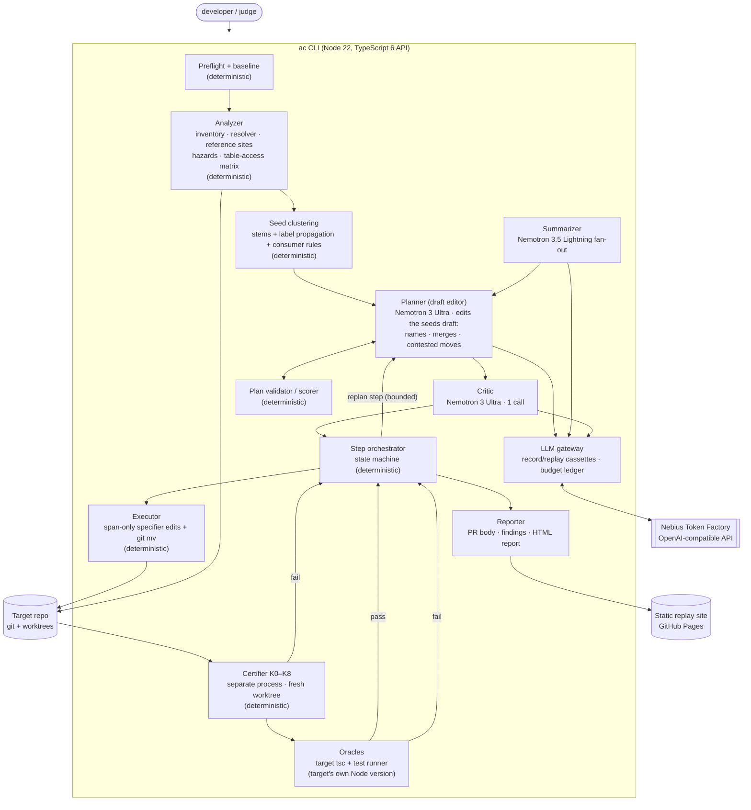

# architecture-cleaner: plan

Status 2026-10-02, updated after the gate session (S2): G2 passed, G1 failed criterion 1, so the planner follows the §6 pivot; G3 came out messy. Numbers and the full list of corrections are in [gates.md](gates.md). This plan owns scope, architecture, budget, gates and timeline. Research behind it lives in `docs/research/`. `docs/kickoff.md` is history.

## 0. In one paragraph

architecture-cleaner turns a TypeScript backend sliced by technical type (`controllers/ services/ repositories/ dtos/`) into feature modules, through a ladder of single-purpose commits.
- NVIDIA Nemotron on Nebius Token Factory **only draws the map**. After G1, that means it edits a deterministic draft: it names and merges modules, decides the contested files and says why.
- A deterministic codemod moves the files.
- An independent checker issues a **certificate** per commit: nothing changed but file paths.
- Bugs the new layout makes obvious are **recorded, never fixed**.
- Generated boundary rules freeze the result.

Pitch: *merge an architecture change on proof, not on trust in the AI or your test suite.*

## 1. What research changed vs the kickoff notes

| Kickoff assumption | Finding | Consequence |
|---|---|---|
| Novelty = deciding where files go plus proving it | **`@demlik/structure-sweep`** (npm, published 2026-09-24) already does LLM file→feature+role classification, a graph-agreement gate, ts-morph moves, pinned entrypoints, a boundary ledger and blind-mode scoring. "LLM decides, AST executes" is commodity (Kiro, ts-morph MCPs, Katana, EM-/MM-assist). | The **certificate** and the **never-fix discipline** are the hero. Competitors get named on a prior-art slide. |
| ts-morph `move()` as the executor | It strips `.js`/`.json` extensions, ignores `paths`, normalizes every relative specifier, and is superlinear (#1612, #837, #1613). | Our own executor on the **TS 6.0 compiler API**, with span-only edits. TS 7 (npm `latest`) has **no JS API**, so pin `typescript@6.0.x`. |
| Certificate = AST equality + graph equality + hazard scan | 10+ false-certificate holes: relative→alias rewrites that crash prod, Jest/Vitest snapshots or `__mocks__` left behind, glob loaders with the same set but a different order, hooks reordering imports, `rootDir` drift, gitignored destinations. Raw TS API vs ts-morph isn't independent (ts-morph bundles TS 6). | Redesigned as K0–K8 (§3.4): byte-span confinement, multi-resolver identity, checks on the commit in a fresh worktree, diversity via the test runner's own resolver plus oxc. |
| Nano for fan-out | **Nemotron 3.5 Lightning**: same price ($0.06/$0.24), 1M context, SWE-bench Verified 51.6 vs Nano's 34–39. Nano looks headed for deprecation. | Use Lightning; drop Nano. |
| Credits are tight | No caching discount, but a full planning run on a ~250-file repo costs **≈$0.50**. The traps are generic-agent loops and benchmarks. | §5: ~$34 planned, ~$17 reserve. |
| "Clean Architecture" framing | Inner CA folders on active-record code end up empty or mislabeled, and dependency inversion can't be certified. | For the hackathon, claim "feature modules with enforced boundaries + a frozen inventory of every violation". Clean Architecture is the post-hackathon direction (§2.7). |
| Organizer quote ("code completion is standard") | The actual quote: "a code-completion wrapper is a start; an agent that plans, writes, tests, and iterates on a real repo with minimal human input is where it gets interesting". | The planner is a real agent: tools, an evaluate/refine loop, and replanning on certificate failure (§3.5). |
| Ultra 71.9% SWE-bench Verified | The card says 70.7 (BF16) / **69.5 (NVFP4, the variant TF serves)**. | Corrected. |
| Demo on a small, curated repo | Popular repos do apply. **immich** (115k★) has a purely type-sliced server with 2,337 offline unit cases (G2). Its maintainers hand-restructured it in about 17 layout PRs over ~52 h (March 20–22, 2024). | immich is the primary demo target (§2.6). |

## 2. Scope

### 2.1 Positioning and claims

- **Say:** "certificate", "mechanically checked under stated assumptions", "first we know of for TypeScript", "feature modules with enforced boundaries".
- **Never say:** "formally proven", "zero risk", "verified" without saying what is verified, "first AI refactoring tool", "Clean Architecture" as a description of what ships. Presenting Clean Architecture as the future direction is fine (§2.7).
- **Prior-art slide and README section:**
  - structure-sweep: the closest; credit its dual-opinion gate and blind mode.
  - Kiro smart relocate and ts-morph MCPs: commodity moves.
  - specialist-agent `/migrate-architecture`: generic-agent restructuring.
  - SonarQube Architecture and dependency-cruiser: boundary freezing.
  - Literature: translation validation (Pnueli 1998, Necula 2000) and name-binding preservation (Schäfer et al.).
- **Impact lever:** `ac certify` works on **any** diff. That covers other agents' refactors and humans' too, e.g. immich's 2024 manual reorg PRs.
- **Target hygiene (license analysis):**
  - Target code never enters our repo; targets are cloned at runtime by SHA.
  - Excerpts are labeled with repo@SHA, path and license.
  - Forks keep LICENSE/NOTICE and add a modification notice.
  - No target logos in the video.
  - Accept OSI targets. Reject SUL (n8n) and EE/commercial directories.

### 2.2 Target layout: `feature-flat` (the default; the only profile demoed)

```
src/
  modules/<module>/        # singular kebab-case domain noun from the repo's own vocabulary
    <stem>.<role>.ts       # after R3; closed role vocabulary, but the repo's own word is kept (dao stays dao)
  shared/                  # pure (no I/O or framework), ≥2 module consumers, a leaf; concept file names
  platform/                # plumbing: config, database, logger, http (generic middleware), queue, telemetry, registries
  <entrypoints>            # pinned: main/server, workers, bin, migrations/schema, generated code
```

- **Banned module names:** common, core, misc, general, helpers, utils, lib, base, manager, shared, platform, plus type words.
- **Naming source:** the LLM never invents business terms. Names come from route prefixes, table/model names and file stems.
- **Composition roots** (DI registries, route mount tables) may move, e.g. into `platform/`, when the move is certifiable like any other.
- **Knobs** exist for an honest support envelope and are not demoed: `moduleRoot`, `moduleNumber`, `fileNaming` (`dot-role|preserve`), `layout` (`flat|layered`), plus a package root (e.g. immich `server/`).

### 2.3 Step ladder

Every commit carries a certificate.

| Rung | What | Commits | Status |
|---|---|---|---|
| R0 | **Preflight + baseline.** Inventory, tsc, tests ×2 (quarantine flaky ones), resolved graph, hazard scan, pinned set, table-access matrix (module × model/repository, reads/writes). Unfit repos are declined with reasons. | – | MVP |
| R1 | **Module moves.** Single-owner files go to `modules/<m>/` with basenames kept. Co-located tests and specs move with their subject. Contested files are moved per plan and flagged. | 1 per module | MVP |
| R2 | **Residual consolidation.** Leftovers in `utils/`, `middlewares/`, `config/` and the registries go to `shared/` or `platform/`, or into the single consuming module. | 1–2 | MVP |
| R3 | **Filename normalization**, e.g. `userController.ts`→`user.controller.ts`, `view-repository.ts`→`view.repository.ts`. Only casing and separators change; stem and role word are kept, and unparseable names are left alone. Filename-observability guard: `__filename`/basename use, name-from-file DI, snapshot pairing, path strings, suffix-keyed tooling such as the Nest Swagger plugin's `.dto.ts`/`.controller.ts`. | 1 per module | MVP (corupta) |
| R4 | **Boundary rules.** dependency-cruiser config with:<br>• a module DAG allow-list<br>• a barrel-less public-file allow-list<br>• `shared` is a leaf<br>• `platform` ↛ `modules`<br>• controller ↛ persistence<br>• a folder-scope cycle rule<br>Current violations go to the `--baseline` known-violations file. An **anti-vacuity check** proves each rule fires on a synthetic violation in a scratch copy. | 1 | MVP |
| — | **Findings log.** Deterministic findings with LLM-written narration, in the PR body and report, and **never fixed**. Examples: module cycles, back-edges, multi-writer tables, god files with per-function affinity, `BaseService`-style god injection, prod→test imports, lint rules the move now trips (e.g. import order: fixing it would reorder evaluation in a cycle). | — | MVP |
| S1 | Tests follow their subject: mirrored test trees get reorganized per module; snapshots and `__mocks__` co-move. | per module | Stretch 1 |
| S2 | Independent checker extractor/resolver (oxc-parser + oxc-resolver) | — | Stretch 2 |
| S3 | **Whitespace-only re-wrap** of touched import lines (prettier `printWidth`), certified by token-stream equality | 1 | Stretch 3 |
| S4 | Runtime load trace (resolver hook + boot smoke): ordered `(parent, specifier, resolved)` equality | — | Stretch |
| S5 | Scoped mode (a subset of type folders) plus an "adopt existing feature root and house naming" profile, for stalled-migration targets (Unleash, paperclip) | — | Stretch |
| S6 | Opt-in `layered` inner folders; report-only draft ports per frozen violation; type-only shared-kernel splits | — | Stretch |

**Non-goals:**
- symbol renames;
- adding or dissolving barrels;
- reordering imports;
- dependency inversion as code (the post-hackathon direction, §2.7), god-class splits, dedup;
- **fixing any bug, ever**;
- generating NestJS `*.module.ts`;
- JS targets (post-hackathon, corupta's Sequelize repo);
- frontend repos;
- cross-package monorepo moves;
- editing configs beyond proven match-set equality (MVP declines instead);
- a live public endpoint on our key;
- Nebius AI Cloud compute;
- n8n (license).

### 2.4 Never touch (pin)

Importers of pinned files still get specifier rewrites. When in doubt, pin.
- **Entrypoints:** `main`/`bin`/`exports`, scripts, Docker/Procfile/serverless, `nest-cli.json`, worker files loaded by path.
- **Published import surface.**
- **Migrations, schema dirs, seeders and their config** (the DB stores names and order).
- **Glob, convention and file-name-loaded files:** ORM globs, routing-controllers, awilix, fastify-autoload, swagger-jsdoc `apis`, readdirSync loaders, sequelize-cli `models/index`.
- **Ambient `.d.ts` files.**
- **Generated code.**
- **The oracle:** configs, integration/e2e/medium tests, fixtures, test utils.
- **Location-sensitive files:** `__dirname`, `import.meta.*`, cwd paths, `require.resolve`, non-literal `require`/`import()`/mocks, workers/fork, `fs` path literals.
- **Pre-existing re-export barrels** (legacy facades, specifiers rewritten).
- **Non-TS assets.**
- **Lockfiles and manifests.** No new path aliases, ever.

### 2.5 Support envelope: preflight declines with reasons

- non-TS majority;
- nested `package.json` `type`/`imports` or tsconfig scopes over movable code;
- `automock: true`;
- unknown runtime alias mechanism;
- symlinks in movable dirs;
- `.ts`/`.js` same-stem pairs;
- non-reproducible generated code;
- test config that can't be loaded statically;
- suite not green at baseline.

Declining a poor fit is itself a demo beat: cool-admin-midway derives HTTP routes from file paths.

### 2.6 Repos

| Role | Repo @ SHA | Why |
|---|---|---|
| **Demo (primary)** | **immich-app/immich `server/`** @`02063972e8` · AGPL-3.0 · 115k★ | See the list below this table. |
| Backup 1 | Dokploy/dokploy @`48504fde4e` · Apache-2.0 (outside `/proprietary`) · 37.6k★ | Two type-sliced trees (`packages/server/src` services/schema/utils + app routers); ~45 clean domains. G2: 1,092/1,097 offline vitest cases (5 skip without Docker), about 2 min, dominated by module loading. Typechecks with TS 7 tsgo only. Node 24.4; node-pty builds from source on aarch64; proprietary dirs pinned; one ungated real-deploy test must be excluded. |
| Backup 2 | samanhappy/mcphub @`70cf036c90` · Apache-2.0 · 2.5k★ | Simplest full fit; **Jest**, so it covers the Jest half of the checker. G2: 1,986 cases in 226 files. 7 files need network (6 through the DNS lookup in `utils/ssrf.ts`, 1 runs `npx time-mcp`), so quarantine them or preload a DNS stub. `utils/path.ts` makes a depth assumption that tests skip ("tests can't see it, the certificate did"). |
| Checker bring-up | openhab/openhab-cloud @`76966b546b` · EPL-2.0 | CJS, acyclic, mocha unit tests (G2: 454/454 in 31 files), no aliases. The unquoted test glob runs only files one directory below `tests/mocha/unit`. |
| Rejected (reasons in `docs/research/03c`) | n8n (SUL license, module-registry clash), supabase/opencode/nest/vscode/Apache (not type-sliced backends), NocoDB (SUL, no real tests), Unleash and paperclip (scoped stretch only: Postgres globalSetup / 53-min suite, convention clash), Directus (non-OSI), Budibase/ToolJet/PeerTube (tests need services) | |

Why immich for the demo:
- **Fit:**
  - `server/src` is purely type-sliced NestJS: controllers/services/repositories/dtos, ~250 movable files, ~37 domains.
  - DI is by class reference, all specifiers use the `src/` alias, and files are already named `<stem>.<role>.ts`.
  - It qualifies as a whole package (full mode), with pins on schema/migrations, workers, bin, emails and 3 location-sensitive files.
- **Oracles:**
  - 2,337 offline vitest unit cases in 105 files (G2: green twice, 0 flaky, TS 7 tsc 0 errors);
  - a byte-identical **OpenAPI spec** oracle (`nest build` + `sync-open-api`, verified offline twice). Run it from a scratch cwd, because it writes `../open-api/immich-openapi-specs.json` relative to cwd.
- **Findings:**
  - `BaseService` injects 55 repositories into every service;
  - an 87-file import cycle;
  - god files;
  - naming drift.
- **Hook (corrected in G2):** the maintainers restructured by hand in March 2024: about 17 layout PRs over ~52 h (Mar 20–22). Most are pure moves. #8080 moved nothing: it rewrote imports to absolute `src/…` paths, deleted 42 barrels and removed the path aliases. #8118, #8131, #8138, #8152, #8156 and #8201 merge or split files. Only the domain layer had been feature-sliced. The tool makes such a migration mechanical and provable, and `ac certify` can audit those very PRs, though the merge PRs fall outside the move-only certificate.
- **Costs:**
  - Node 24 (project-local);
  - building `@immich/plugin-sdk`/`@immich/sdk` first;
  - TS 7 typecheck (the repo's `tsc` is the K8 oracle; our analysis uses the TS 6 API with the same options);
  - prettier/import-order lint gates trip on rewritten specifiers (→ finding + S3);
  - optics of "reversing their choice" (framed as a lens, not a verdict).

**Scramble benchmark.** These repos are already feature-modular; we flatten them into type folders and score recovery.

| Repo | Role |
|---|---|
| hoppscotch backend (MIT, 761 offline cases in 19 files) | Flagship, with traps |
| kaneo `apps/api` (Hono, MIT, 849 offline cases in 112 out-of-tree files) | Low name leakage |
| ghostfolio `apps/api` (AGPL) | Alias `jest.mock` |
| amplication-server, ultimate-nest | Optional |
| mikro-orm realworld | Smoke test |

**Real-world recovery (secondary, after G2).** Take immich @`6e93ddf2` (type-sliced, right after the reorg) and score against the maintainers' own former `domain/<feature>/` folders @`40262c30` (2024-03-18). It's feasible, but only 53 files in 25 features carry a human label, and 49 of the 53 give their feature away in the file name. Name tokens score 91.7, seeds 93.8, the v1 planner 93.8. Use it as a face-validity check, never as a headline number. Mapping: `~/ac-work/g2/immich-recovery/gt.rsf`.

Clones go to `~/ac-targets/`, never into this tree.

### 2.7 Future direction: Clean Architecture (after the hackathon)

The hackathon deliverable stops at feature modules with enforced boundaries. Clean Architecture is where the project heads afterwards, built on what ships:
1. **The frozen violation inventory is the starting point.** Every dependency-rule violation is known, located and baselined. That inventory is the work list for Clean Architecture.
2. **Draft ports, report-only (stretch S6).** For each frozen violation, propose a port interface and adapter. The LLM writes the text; nothing in the code changes.
3. **Dependency inversion as code, one port per step.** This changes call sites, construction and DI wiring, so a mechanical certificate can't cover it. It needs a behavioral oracle: golden-master or differential runs, the existing tests, and contract diffs such as immich's OpenAPI spec. The ladder, the never-fix discipline and the findings log all carry over.
4. **Honest inner layers.** Where files really are framework-free, opt-in `layered` folders (`http/ application/ domain/ infrastructure/`) become true rather than decorative.
5. **JS targets,** starting with corupta's private Sequelize repo.

**In the demo:** a short future-direction beat at the close (§9), only if it fits the 3 minutes. Point to the frozen violations on screen: "today we enforce and freeze them; next we invert them, one verified port at a time."

## 3. Tool architecture

### 3.1 Diagram



### 3.2 Agents vs deterministic code

| Component | Kind | Why |
|---|---|---|
| Planner | **Agent editing a deterministic draft** (Ultra, `medium_effort`) | Judgment: names, merges, contested files, shared vs platform, multi-writer owners. G1: it beats the best deterministic baseline by ≥5 MoJoFM only on opaque-name H1 (+6.2), by +1.4 on hoppscotch, and loses on kaneo (−12.3). Its best sample adds +1 to +6 over its own draft. |
| Summarizer | LLM fan-out (Lightning) | One-line purpose for ambiguous files; cheap and parallel |
| Critic | LLM (Ultra, 1 call) | "Senior architect review", module-name polish and report narration. The track hint says "Ultra for serious reasoning". |
| Findings narrator | LLM (Lightning/Super) | Prose for deterministic findings; text only |
| Analyzer, seeds, validator, orchestrator, executor, certifier, oracles, reporter | **Deterministic** | Soundness: no LLM output can produce a false certificate. Also reproducibility (replay), cost and judge trust. |

The track's agent loop: seeds draft → Nemotron edit → validate → execute → certify/test → on failure roll back, **replan the step** (bounded to 2 attempts), else pin and log a finding. The evaluate/refine round is off by default after G1 (§3.5).

### 3.3 Executor: resolve → map → respecify → re-resolve

1. **Inventory from `git ls-files`.** Group files by tsconfig option set, with a TS 6 legacy-resolution shim: `node10` when unset on repos below TS 6, plus `ignoreDeprecations: "6.0"`.
2. **Extract every reference site, with its span:**
   - import/export, `import type`, `import =`, `import()`, `typeof import()`;
   - `require`/`require.resolve` in `.ts`;
   - the `jest.*`/`vi.*` mock family (with the `virtual` flag);
   - `declare module '<relative>'`;
   - triple-slash references;
   - asset specifiers.
3. **Resolve:** TS sites via `ts.resolveModuleName`; test-runner sites via Jest or Vite semantics (`moduleNameMapper`, aliases, `roots`); assets via the filesystem.
4. **Map** with `pathMap` plus co-move bundles (siblings, `__mocks__/<basename>`, `__snapshots__`).
5. **Respecify** with `ts.moduleSpecifiers.updateModuleSpecifier`, then a post-pass that **keeps the form class**: relative stays relative, the alias key stays, and the `.js` ending and `/index` style stay.
6. **Edit inside the quotes only,** with a slice guard, preserving BOM and CRLF. Never apply TS's tsconfig edits. Then `git mv`.
7. **Self-verify on a virtual post-move host:** every site satisfies `after == map(before)`, unresolved sites stay unresolved, and `impliedNodeFormat` is unchanged.
8. **Differential oracle:** TS `getEditsForFileRename`, plus fixture repos per capability row and random-`pathMap` fuzzing.

Estimate 20–32 focused hours (MVP cut 16–20).

### 3.4 Certificate per commit (MVP in bold)

| Id | Check | Catches |
|---|---|---|
| **K0** | Envelope preflight (§2.5) | out-of-model repos |
| **K1** | Move-set integrity:<br>• `pathMap` is total and injective<br>• no case-only renames<br>• `git ls-tree` of the **commit** == `pathMap(old tree)`, with modes equal<br>• co-move bundles complete<br>• ignore-file match status unchanged | gitignored destinations, lost exec bits, orphaned mocks/snapshots |
| **K2** | Byte-span confinement: new bytes == old bytes outside recognized specifier spans and recognized config path strings | any non-path edit: reordering, formatting, `import type` toggles |
| **K3** | Multi-resolver identity over **all** tracked files. Ordered site lists resolve to `map(before)` under (a) TS with the repo's options, (b) the test runner's resolver (Jest `moduleNameMapper` / Vite aliases), (c) the runtime alias mechanism. Form class is preserved. | wrong-target rewrites, shadowing, alias-only-in-tsc crashes, missed mocks |
| **K4** | Location scan:<br>• moved files and files whose targets moved contain no path-exposing APIs<br>• an old-path string scan over all tracked files (docs hits become findings) | `__dirname` assets, cwd paths, infra/CI path strings |
| K5 | Ordered glob/loader match lists plus per-file compile-context fingerprint. MVP: pin loader targets; decline nested scopes. | loader order, ESM/CJS flips |
| **K6** | Test inventory (Jest **and** Vitest):<br>• `--listTests` / `vitest list` equal modulo `pathMap`<br>• mock resolution equal<br>• no new name collisions<br>• run with `CI=true` / `--ci` and `snapshot.added == 0`<br>• per-file case counts **and file-load status** equal (G3: the immich single-shot still reported 2,337/2,337 cases while 66 spec files failed to load) | silent test drops, unloadable specs, vacuous snapshot passes, automock flips |
| K7 | Emit layout: each pinned entry's emitted path is unchanged. MVP: require an explicit `rootDir`, or decline. | `dist/src/server.js` → `dist/server.js` |
| **K8** | Oracles on the **commit in a fresh worktree** (hooks bypassed and recorded, `HUSKY=0`), with the target's Node version: target tsc (`--incremental false`; hoppscotch gates on `tsconfig.build.json`), test suite (test identity = file + name + ordinal), plus per-target extras (immich: OpenAPI spec byte-diff, run from a scratch cwd) | anything the static model misses on exercised paths |

**Independence**
- The certifier is a separate process that reads only the two committed trees.
- It infers `pathMap` by matching content hashes with specifier spans blanked, so it certifies **any diff**.
- K3(b) uses the runner's own resolver (ground truth for tests).
- S2 adds oxc as a separate implementation.

**Trusting the checker**
- A mutation harness with the red-team's 32 operators, e.g.:
  - retarget to a same-basename file;
  - drop a mock rewrite;
  - leave `__mocks__` behind;
  - reorder imports;
  - relative→alias;
  - move a `__dirname` user;
  - flip loader order;
  - stage into a gitignored path.
- Requirement: **100% killed by K0–K7 without K8**. Mutants that only tests catch are logged soundness holes.
- Cross-check on OSS repos: "certificate ✓, tests ✗" = a hole.

**Residual risk listed in every PR:**
- external consumers;
- runtime fs contents;
- env-dependent resolution;
- stack-trace text;
- CI triggers and CODEOWNERS routing.

### 3.5 Planner

1. **Facts** (deterministic, ~80 tokens per file; immich ≈ 20–28k tokens):
   - per file:
     - id, path, role, LOC;
     - exported symbols;
     - resolved symbol-level edges (through barrels);
     - table/repository reads and writes;
     - pin/hazard flags;
     - a Lightning one-liner (ambiguous files only).
   - Plus the module quotient graph with SCCs, the table-access matrix, entrypoints and pins.
2. **Seeds** (deterministic):
   - stems from models/repositories/controllers/routes and table names;
   - name-token assignment with prefix merging;
   - weighted label propagation on import + table edges;
   - consumer rules for cross-cutting files;
   - output: a draft plan with per-file confidence and a contested list.
3. **Planner = draft editor** (after G1; the §6 pivot):
   - Input: the facts plus the seeds draft as numbered groups G1..Gn.
   - Output (`json_schema` strict): one entry per draft group (final bare name and kind; equal names merge), plus moves for misplaced files only, each with a one-line rationale. The model never lists every file. G1's v0 did: it dropped 10–15% of hoppscotch's 189 ids and 26–45% of kaneo's 456, listed up to 259 duplicate entries on immich, or collapsed to one group.
   - Model: Ultra with `medium_effort`. It made the best edits on hoppscotch and H1 and the only real immich edit, though it also lowered the kaneo draft by 9 points. Super only with an explicit `temperature` and a reasoning cap: at default effort 11 completions truncated at 32k–64k tokens, and at `low_effort` it mostly returned the draft unchanged (0 moves in 5 of 8 samples; one sample made 87 moves and lost 29 points).
   - Optional tools (`file_facts`, `evaluate_plan`) stay, but **the evaluate round is off by default**. In G1 it hurt 6 of 17 samples, 4 by more than 10 points. We suspect, but haven't tested, that the cycle and cross-edge feedback rewards merging.
   - Job: name modules; merge or split seeds; decide contested files; pick multi-writer owners; propose findings.
4. **K candidates** come from one call with `n=K` (Super reports the input once in `usage`; Ultra's `n>1` is unprobed) at an explicit T=1.0 and top_p=0.95. TF decodes Super greedily when `temperature` is unset. GT-free selection is an **open problem**: TurboMQ ranked the unedited draft first on immich. Until it's solved, rank by validator metrics plus the critic, and show the alternatives in `plan.md`.
5. **Critic** (Ultra, 1 call): reviews the winner. Its suggestions go back through the validator, never straight to execution.
6. **Dual-opinion flag** (credit: structure-sweep): files where the plan disagrees with the graph majority are listed as "contested". `plan.yaml` can be edited between `plan` and `apply`.

### 3.6 LLM gateway (Token Factory facts verified 2026-10-01)

**Client and models**
- openai npm SDK with `baseURL https://api.tokenfactory.nebius.com/v1/` and `NEBIUS_API_KEY` from a gitignored `.env`.
- IDs live in config:

  | Model | ID | Context | $/M in · out |
  |---|---|---|---|
  | Super | `nvidia/nemotron-3-super-120b-a12b` | 262K | 0.30 · 0.90 |
  | Ultra | `nvidia/Nemotron-3-Ultra-550b-a55b` | 1M | 1.00 · 3.00 |
  | Lightning | `nvidia/Nemotron-3_5-Lightning` | 1M | 0.06 · 0.24 |

**Request handling** (verified by the gate-session probes, [gates/tf-probes.md](gates/tf-probes.md))
- **Structured output:** `response_format: {type: "json_schema", strict: true}` is enforced on Super, Ultra and Lightning, with thinking on or off, even though the catalog doesn't tag it. zod still validates. The forced named tool stays as a fallback. Never use `tool_choice: "required"` on Lightning: it loops.
- **Reasoning:**
  - Control it with `chat_template_kwargs`: `enable_thinking`, `low_effort` (Super), `medium_effort` (Ultra). These pass through at top level or inside `extra_body`. Don't use `reasoning_effort`, which maps inconsistently.
  - Read `reasoning_content` only. Super and Lightning mirror it into `reasoning`; Ultra doesn't.
  - **Always set `max_tokens`.** On `finish_reason: length`, never parse `content`: Ultra and Lightning leak raw reasoning into it.
  - Thinking off costs answers (every thinking-off probe answer was wrong), so the planner keeps thinking on.
- **Sampling:** always send `temperature: 1.0, top_p: 0.95`. Without it, Super decodes greedily and rejects `n>1`.
- No prompt-caching discount, so keep prompts compact.
- `store: false`.
- Rate-limit headers: Lightning returns `x-ratelimit-{limit,remaining,reset}-*`, so the gateway reads them. Super and Ultra return none and report a sentinel catalog limit, so pace them client-side. Back off on 429. `service_tier` is always null.
- Model IDs are case-sensitive.

**Cassettes and budget**
- **Cassettes:** every call recorded as JSONL, keyed by hash(model, messages, tools, params). Modes: `record`, `replay` (fails on a miss), `auto`. They power the demo, our tests and the judges' test build.
- **Budget ledger:**
  - cost per call = `usage` × the pinned price table;
  - a pre-send estimate is refused if it would exceed the run cap or the global cap;
  - the ledger is committed, and it feeds the cost chart.

### 3.7 Our repo (feature folders, dogfooding)

- **Folders:** `src/{cli,preflight,analyzer,seeds,planner,llm,executor,certificate,orchestrator,findings,report,bench}/`.
- **Stack:**
  - TypeScript **6.0.x**, Node 22; target oracles run on the target's own Node via project-local tarballs.
  - vitest, zod, openai SDK, graphology + louvain.
  - dependency-cruiser, as a library and as the rule output format.
  - execa + the git CLI.
  - Report: static HTML with a small graph library and Observable Plot.
- **License:** MIT.

## 4. Product form factor and demo URL

**CLI (`ac`):**
- `ac preflight <repo>`
- `ac plan <repo>` → `plan.yaml` + `plan.md`
- `ac apply <repo> [--plan]` → branch `ac/restructure`: one concern per commit, certificate trailers
- `ac certify <repo> <base>..<head>`: **any** diff
- `ac report` → a static HTML bundle
- `ac bench <manifest>`
- Every command accepts `--replay <cassettes>`.

**Outputs**
- A bisectable branch.
- A PR description: ladder, findings, residual risks, cost.
- `.dependency-cruiser.cjs` plus a known-violations baseline.
- An HTML report:
  - before/after module graph (type-folder hairball → modules);
  - ladder with expandable certificates;
  - findings;
  - table-access heatmap;
  - A/B comparison;
  - benchmark charts;
  - cost ledger.

**Demo URL**
- A static replay site on GitHub Pages: recorded runs for immich, a backup, the benchmarks and the A/B.
- No live LLM calls, so it costs nothing through Dec 15 and survives model deprecations.

**Test build**
- `npm ci && npx ac demo --replay` replays the whole pipeline on the pinned immich SHA using recorded Nemotron responses: no key, no cost.
- Live mode works with the judge's own Token Factory key.
- The README highlights the Nemotron and Token Factory usage, as the rules require.

## 5. Models, credits and budget

**Credits:** $25 (`NEBIUS-DEVPOST-GLOBAL26`) + $25 (Builders Program) + a $1 trial (30 days) ≈ $51. A card is required and gets auto-charged on a negative balance, so the ledger caps are hard.

**Tiering:**

| Model | Use |
|---|---|
| Lightning | Summaries, narration, a cheap A/B arm |
| Super | The generic-agent baseline model; a planner-editor sample only with an explicit temperature and a reasoning cap (G1) |
| Ultra | Planner-editor (`medium_effort`; best G1 edits on hoppscotch, H1 and immich) plus 1 critic call per run |

**Per-run estimate** (≈250 movable files): before G1 it was Super ≈$0.35 + Ultra ≈$0.10 + Lightning ≈$0.04 → ≈$0.50. After G1 the editor is Ultra: 1 edit call (K via `n=3` if Ultra supports it) + 1 critic + Lightning narration → **≈$0.15–0.25**. G1's Ultra calls averaged $0.03.

| Phase | Cap | Notes |
|---|---|---|
| TF probes | $0.25 | `GET /v1/models?verbose=true` is free (per-model limits and features) |
| G1 boundary spike | $3 | ledger-enforced |
| G3 generic-agent baseline | $8 | immich run capped at $5, mcphub run at $3, with a hard kill at the cap |
| Build-phase prompt iteration | $8 | cassettes mean nothing is paid twice |
| Benchmarks (scramble + immich-2024 recovery) | $10 | ≈5 repos × {default, H1} × {Lightning, Super, +Ultra critic} × 2 seeds |
| Final recorded demo runs | $4 | immich + backup, K=3 |
| **Reserve** | **$17** | Never used for anything judge-facing or live |

**Actuals after S2 (2026-10-02):** $7.54 spent. Probes $0.025, G1 $1.70, G3 immich $4.93 (stopped by the hard cap), G3 mcphub $0.86, smoke test $0.014. Left: about $43 of $51. With no caching discount, one 33-minute generic-agent run resent 15.3M input tokens. Agent loops are the budget risk, not planner runs.

## 6. Gates (ran 2026-10-02, see [gates.md](gates.md)). Decision: Tue Oct 6

**Before the gates (corupta, ~15 min):** create the Token Factory account, add a card, redeem both $25 credits, create an API key and put `NEBIUS_API_KEY` in `.env`.

Spike code goes on branch `spike/gates`. Only the gate report and the feedback log merge to main.

**G2: repo health** (first; no LLM)
- **Procedure:**
  - Clone the candidates at their pinned SHAs into `~/ac-targets/` and install with project-local Node: 24 for immich and Dokploy, the declared version for the rest.
  - Run tsc and the unit suites twice.
  - Run offline (outbound network blocked if the container allows it; otherwise a dead-proxy env).
  - Record install result, time and pass/fail per file.
  - Also check feasibility of the immich 2024 recovery benchmark (`6e93ddf2` vs `40262c30` mapping).
- **Pass:**
  - immich unit tests green offline (≥1,500 cases);
  - openhab-cloud green;
  - ≥3 benchmark repos green.
- **Else:** promote Dokploy or mcphub; demote benchmark repos to Tier M (tsc + certificate only).

**G1: boundary spike** (≤ $3)
- **Procedure:**
  - Analyzer v0: inventory, TS-resolved graph, roles.
  - **Virtual scramble:** apply the flatten `pathMap` to graph node names. Ground truth is the original feature folders, so no executor is needed. NestJS modules use Variant A.
  - Baselines:
    - B0 type-folders;
    - name-token;
    - Louvain;
    - seeds + label propagation.
  - Planner v0: Super, facts + draft, 1 evaluate round, 2 samples, plus 1 Ultra sample.
  - Metrics on feature files and on **hard files** (where name-token is wrong): MoJoFM (TS port validated against ARCADE oracles), ARI, c2c_cvg@0.66, cluster-count ratio.
  - Repos: mikro-orm realworld (smoke), hoppscotch, kaneo, hoppscotch-H1.
  - Then a real plan for immich @SHA as a one-page summary for corupta: modules, file counts, contested files with rationale.
- **Pass** (both):
  1. [LLM-assisted ≥ best deterministic baseline + 5 MoJoFM on ≥2 of 3 repos] **or** [≥ +15 points on hard files];
  2. corupta rates the immich plan ≥3/5 ("I'd accept it after changing ≤10% of placements").
- **Fail:**
  - Spend ≤1 day on variants: input format, tool exploration, Ultra as planner.
  - Still failing → **pivot**: deterministic seeds decide; Nemotron arbitrates contested files and writes names, rationale and findings. The certificate stays the hero.
  - **Stop** only if no planner reaches ≥3/5.

**G3: generic-agent baseline** (≤ $8)
- **Harness:**
  - opencode on the Token Factory provider. Nebius has an official TF+OpenCode cookbook by a TF DevRel lead who is a judge.
  - Model: Super.
  - A local OpenAI-compatible **metering proxy** counts usage and hard-stops at the cap.
  - Fresh clone at the pinned SHA, no human input, 90-min wall cap.
  - Targets: immich ($5), mcphub ($3).
- **Prompt (fixed):** "Restructure this repository from technical-type folders (controllers/services/repositories…) into a feature-oriented Clean Architecture layout. Do not change behavior. Make sure the type check and the tests pass."
- **Measure:**
  - completion;
  - tsc and test deltas;
  - test-inventory count;
  - snapshots added;
  - created, deleted and barrel files;
  - non-specifier edited lines in moved files;
  - stale mock strings;
  - location-sensitive breakage (boot smoke, OpenAPI diff);
  - "fixes" (hunk sample);
  - tokens, $, turns, time.
- **Keep the branches and transcripts.** The certifier re-checks them later for the video.
- **Protocol after S2:** report both variants. Single-shot is `opencode run` with the fixed prompt; it quit within 3 minutes on both targets (48 s and 169 s). Persistent adds automated replies: whenever the agent stops, a fixed message reports typecheck/test pass-fail plus the output tail and asks it to continue, until the checks are green, 90 minutes pass, 25 turns are used, or the cap is hit. Persistent is the reference baseline.
- **Messy** (pitch holds) if any of:
  - tsc or tests regress;
  - ≥1 behavior-relevant change the tests don't catch;
  - >5% non-specifier lines in moved files;
  - the run is incomplete.
- **Clean:** re-pitch as "it may get lucky; without a certificate you can't know", plus cost and determinism.

**Decision memo** `docs/gates.md` (one page): build/pivot/stop, demo repo confirmation, plan corrections.

## 7. Benchmarks

**Scramble procedure**
- Classify each file's type: suffix → nearest type folder → AST.
- Target path: `<root>/<plural(type)>/<basename>`.
- Name collisions: rename from the primary exported symbol; otherwise add a module-token prefix (counted as leakage).
- NestJS `*.module.ts` files move unchanged to a `modules/` type folder (Variant A), reported with a DI-oracle baseline.
- Scrub the answer from history, CODEOWNERS, `CLAUDE.md`/`AGENTS.md` and renovate path groups.

**Variants**
- The scramble runs on **our executor and certificate** (dogfooding).
- H1 variant: opaque filenames.

**Metrics**
- MoJoFM is the headline, alongside ARI, c2c_cvg and cluster-count ratio. They're always shown next to the B0, name-token and Louvain baselines.
- Real targets have no ground truth, so use TurboMQ and back-edge counts.
- ICSA 2026 found classic methods beat LLM decompositions by 62% on MoJoFM, so baselines are mandatory. G1 agrees: Louvain beat every LLM plan on kaneo.
- Baseline set (from G1): B0 type folders; name-token (full stem and anchored with prefix merging); export-symbol tokens, which survive H1; seeds + label propagation from both seed sources; Louvain at resolutions 1, 2 and 4 × 5 seeds. Headline = the best of them.
- Correction to research 03b: with B = 3×3, both all-singletons and one-cluster score MoJoFM **0**, not 14.29 (brute-force checked). Degenerate partitions score low in general but not always 0, so keep the cluster-count ratio next to MoJoFM.

**Real-world recovery:** immich @`6e93ddf2` vs its own pre-reorg modules @`40262c30`, if G2 finds it feasible.

## 8. Timeline

Today is Fri Oct 2; the deadline is Fri Oct 30, 10:00 PT. Sessions are Claude sessions corupta starts, and each one ends with the next session's prompt.

| Dates | Session / milestone | corupta |
|---|---|---|
| Oct 2–5 | **S2 gates:** TF probes → G2 → G1 → G3 → `docs/gates.md` | 15 min setup |
| **Tue Oct 6** | ◆ build/pivot/stop + demo repo | 30 min |
| Oct 6–8 | S3: scaffold, analyzer, executor, fixtures, GEFR differential; bring-up: one openhab-cloud module end to end | — |
| Oct 8–10 | S4: certifier K0–K4, K6, K8 (Jest + Vitest), mutation harness ≥20 operators; `ac certify` on the G3 branches (first A/B numbers). **Storyboard locked Oct 9.** | 15 min storyboard OK |
| Oct 10–13 | S5: LLM gateway (cassettes, ledger), seeds, planner agent, validator, K candidates, critic, `plan.yaml` | — |
| Oct 13–15 | S6: orchestrator R0–R4, findings, end to end on immich | **Oct 14: 1 h review** |
| Oct 15–18 | S7: reporter + replay site v1, scramble tool, benchmark runner + runs | — |
| Oct 18–20 | S8: stretch S1–S3, polish, README draft | — |
| **Tue Oct 20** | ◆ **Feature freeze** | — |
| Oct 21–22 | Final recorded runs; numbers frozen Oct 22; site deployed; repo public | — |
| Oct 22–23 | Script, shot list, scripted recordings (VHS tapes, Playwright captures), captioned rough cut | 15 min script OK |
| Oct 23–24 | Voiceover | 1–1.5 h |
| Oct 25–27 | Cut and captions → YouTube; README final; Devpost text; feedback write-up; Built With | 30 min final review |
| **Wed Oct 28** | ◆ **Submit** | 15 min |
| Oct 29–30 | Buffer only | — |

**Cut order if late:**
1. Stretch rungs.
2. Benchmark repos (keep ≥3).
3. K-candidates → K=1.
4. R3 renames.
5. Report polish.

**Never cut:** the certifier, the A/B, the video.

## 9. Video storyline (≤3:00, "a pitch, not a tutorial")

1. **0:00–0:15 Hook**
   - "In March 2024, immich's maintainers restructured their server by hand: about 17 PRs over two days. Big restructures are done by hand because nobody can prove a tool, or an AI, didn't change behavior."
   - Show their tree.
2. **0:15–0:40 The failure**
   - opencode on **NVIDIA Nemotron 3 Super via Nebius Token Factory** (said aloud) restructures immich. Real G3 numbers only: it copies 211 files and corrupts every rewritten import. Yet vitest still reports **2,337/2,337 passing**, because the 66 broken spec copies never load.
   - Then `ac certify` on its branch turns red: duplicated files, non-move edits, unloadable specs, broken OpenAPI build.
   - "Green test count, broken build." On the persistent branch, two moved files also lose their `import.meta.dirname` paths (migrations, helmet.json) with no unit test noticing.
3. **0:40–1:30 Ours**
   - "Nemotron draws the map": the plan view, a contested file's rationale, the table-access matrix, Ultra's review line.
   - The ladder runs: codemod → certificate checks tick → tests and the OpenAPI byte-diff → commit.
   - A seeded wrong move turns the certificate red → rollback → the agent replans.
4. **1:30–2:05 Result**
   - The module graph morphs: 47 controllers, 56 services and 57 repositories become ~35 modules.
   - A new forbidden import fails the boundary rules.
   - Findings "made obvious, never fixed": `BaseService` injects 55 repositories; an 87-file cycle; the linter wants imports reordered, which would change evaluation order, so we don't.
5. **2:05–2:35 Credibility**
   - Recovering immich's own 2024 modules, plus scramble benchmarks vs baselines.
   - The checker kills 32/32 mutants.
   - `ac certify` audits immich's 2024 manual PRs.
   - Cost per run on Token Factory, with the tier chart.
6. **2:35–2:55 Close**
   - "Nemotron draws the map. Code moves it. A checker proves nothing else changed."
   - Optional, about 5 s, if time allows: the future direction (§2.7). "Next: from enforced boundaries to Clean Architecture, inverting each frozen violation one verified port at a time."
   - Repo and site URLs.

corupta records only the voiceover; every visual is scripted and re-renderable.

## 10. Scoring per judging criterion (1–5 each, equal weight)

- **Technological Implementation**
  - A resolver-exact executor on the TS 6 API.
  - A multi-resolver certificate, mutation-tested, with the kill rate published.
  - A Nemotron draft-editor agent over deterministic seeds, with measured gains and losses against strong baselines (G1).
  - Measured model tiering.
  - Cassettes and a budget ledger.
  - Benchmarks with baselines, including human ground truth (immich 2024).
- **Design** ("complete product")
  - plan → edit → apply → certify → report;
  - an editable plan;
  - a PR-ready bisectable branch;
  - preflight that declines with reasons;
  - the replay site;
  - a one-command, zero-cost test build.
- **Potential Impact**
  - Restructures cost top projects days of hand work (immich 2024) or stall for years (Unleash: "we can move it any time", 2023, still not moved).
  - `ac certify` audits **any** agent's or human's structural refactor.
  - Boundary rules stop regression.
- **Quality of the Idea**
  - Translation validation applied to agent refactors.
  - "Make the bugs obvious, then resist."
  - An honest prior-art slide that pre-empts "just a codemod".
- **Bonus: Most Valuable Feedback.** `docs/feedback-log.md` already has ~15 concrete Token Factory doc/catalog defects.

## 11. Risks (ranked)

1. **Video:** the refactor is invisible by design.
   - Mitigation: storyboard Oct 9; the A/B and a red-certificate moment; scripted visuals; rough cut Oct 23.
2. **Novelty attack** (structure-sweep et al.).
   - Mitigation: a proof-led pitch, a prior-art slide, `certify` on foreign diffs.
3. **Plan quality on a tangled popular repo** (87-file SCC, god injection). This one materialized in G1: the LLM beats the best deterministic baseline by ≥5 only on opaque-name H1 (+6.2), by +1.4 on hoppscotch, and loses on kaneo (−12.3).
   - Mitigation: the pivot (seeds decide, Nemotron edits and arbitrates); corupta's 1–5 rating of the immich plan; contested list; editable plan; god structures surfaced as findings.
4. **Checker soundness.**
   - Mitigation: K0–K8, 32 mutants, fresh worktree, multi-resolver checks, careful wording.
5. **immich specifics:**
   - Node 24 / plugin-sdk build / TS 7 typecheck;
   - lint gates (prettier width, import order) trip on rewritten specifiers;
   - "reversing their 2024 choice" optics;
   - daily churn.
   - Mitigation: G2 first; pinned SHA; lint diffs become findings plus S3; framing as "a lens and a proof, not a verdict"; backups Dokploy/mcphub.
6. **Executor gaps:** no TS 7 API, the TS 6 resolution default, mock families.
   - Mitigation: pin TS 6, the shim, GEFR differential tests, fixtures.
7. **Target environment:** aarch64 native deps, heavy installs, offline-ness.
   - Mitigation: pinned SHAs, G2, project-local Node versions.
8. **Token Factory:** deprecations (Nano), no caching, rate limits, per-model quirks (Super's greedy default, reasoning leaking into `content` on truncation). Reasoning/JSON pass-through was verified in S2.
   - Mitigation: replay mode, fallbacks, probes, IDs in config.
9. **corupta's bandwidth** (~10 h).
   - Mitigation: 3 scheduled touchpoints; everything reviewable async.
10. **Target licenses in public artifacts.**
    - Mitigation: OSI-only targets; labeled excerpts; fork notices; no logos.
11. **Scope creep** (R3 in the MVP, Jest + Vitest).
    - Mitigation: the cut order.

## 12. Still unverified

Closed in S2 (see [gates.md](gates.md)): `chat_template_kwargs` pass-through (yes); `json_schema` on Nemotron (yes); per-model rate limits (catalog values; Super and Ultra report a sentinel); offline immich unit tests and OpenAPI oracle on aarch64 with Node 24 (yes); recovery mapping (feasible, secondary); Vitest under `CI=true` (G2 ran every suite that way, with no snapshots involved).

Still open:
- Batch API discount and Nemotron eligibility. `/v1/batches` exists, but nothing documents pricing.
- TF Sandboxes pricing (adopt only if cheap; stretch optics for "run code in Token Factory").
- Promo-code expiry.
- ts-morph/TS 6 spike items. The analyzer spike used the raw TS 6.0.3 API on 5 repos (immich at two SHAs, hoppscotch, kaneo, mcphub, realworld), covering NodeNext, Bundler and node10 with `ignoreDeprecations`. Every internal specifier resolved at base except mcphub's 8 pre-existing broken ones (test scripts importing `./src/...`, and a CSS import).
- dependency-cruiser attribution through barrels.
- A GT-free plan-selection objective (§3.5).
- Whether Ultra accepts `n>1` (§3.5 K candidates).
- Whether `usage` equals billing for `n>1`. Check the console bill.
